I spent years getting paid to break video games. Turns out the skill transfers.
Now I break everything else, then build the tool that should have existed in
the first place, usually because the original was a 2017 Python script held
together by a `requirements.txt` and prayer.

## > the plot twist

A few years back I was charged with aggravated identity theft, wire fraud and
bank fraud. It went to a state trial, and I was acquitted. Ten out of ten,
would not recommend. That chapter's closed: I'm living a good life now, and I
use everything I learned the hard way to build things that make people harder
to rob, not easier.

## > game dev

- 🎮 QA on **Fortnite** (Epic Games) and **The Division 2** (Ubisoft / Red Storm). If you hit a bug in either, statistically I filed it and someone said "won't fix."
- 🧪 Today: test automation, device simulators, and CI/CD triage, aka teaching computers to be disappointed on my behalf.
- 🛠️ Run [**Cloudsculpting Labs**](https://github.com/cloudsculptinglabs): web apps, quant-finance tools, and Raspberry Pi gadgets that work great until they're plugged in.

## > projects

### privacy & opsec
| repo | what it does |
|---|---|
| [**unredact.tools**](https://github.com/NPCmillionaire/unredact.tools) | See what your files leak (GPS, serials, failed redactions, deleted text), then scrub them |
| [**unredact-onion**](https://github.com/NPCmillionaire/unredact-onion) | No-JS Tor front end for unredact.tools |
| [**cryptopastebin**](https://github.com/NPCmillionaire/cryptopastebin) | Zero-knowledge, post-quantum pastebin. The server only ever sees ciphertext |
| [**usbkill-rs**](https://github.com/NPCmillionaire/usbkill-rs) | Anti-forensic USB kill-switch, rewritten in Rust |

### public records & osint
| repo | what it does |
|---|---|
| [**govint**](https://github.com/NPCmillionaire/govint) | Name in, sourced dossier out: SEC, sanctions lists, FAA and more, linked into one graph |
| [**unredact.gov**](https://github.com/NPCmillionaire/unredact.gov) | File FOIA requests and write Congress from your terminal |
| [**capitol-cli**](https://github.com/NPCmillionaire/capitol-cli) | Track House members’ stock trades from STOCK Act filings |
| [**recap-cli**](https://github.com/NPCmillionaire/recap-cli) | Search and download federal court records from RECAP |
| [**OpenCorporatesCLI**](https://github.com/NPCmillionaire/OpenCorporatesCLI) | Company search via the free GLEIF LEI registry |
| [**sherlock-rs**](https://github.com/NPCmillionaire/sherlock-rs) | Hunt usernames across social networks, in Rust |

### offensive security
| repo | what it does |
|---|---|
| [**bettertui**](https://github.com/NPCmillionaire/bettertui) | A friendlier Textual TUI for bettercap |
| [**enum4linux-go**](https://github.com/NPCmillionaire/enum4linux-go) | SMB/AD enumeration, Go rewrite of enum4linux |
| [**amass-wizard**](https://github.com/NPCmillionaire/amass-wizard) | Install and configure all 48 Amass v5 data sources, with live key checks |
| [**nuclei-templates**](https://github.com/NPCmillionaire/nuclei-templates) | Custom Nuclei templates, red and blue |

### music
| repo | what it does |
|---|---|
| [**sp404-app**](https://github.com/NPCmillionaire/sp404-app) | Chop any sound into SP-404 pads in the browser |
| [**its-404-yo**](https://github.com/NPCmillionaire/its-404-yo) | Make any sample pack SP-404 MkII-ready (macOS) |

### markets & misc
| repo | what it does |
|---|---|
| [**wxwhales**](https://github.com/NPCmillionaire/wxwhales) | Follow the biggest wallets in Polymarket temperature markets |
| [**qn**](https://github.com/NPCmillionaire/qn) | Quick-note CLI for Obsidian |
| [**txt**](https://github.com/NPCmillionaire/txt) | Plain-text notes, starting with 222 OSINT tools that mostly work. Trust nothing |

## > toolbox

`Rust` · `Go` · `Python` · `TypeScript` · `Linux (Arch, btw)` · `Raspberry Pi` · `CI/CD` · `test automation`

## > current interests

cinema, complexity, currencies, dance music, e-cash, encryption, feminism, fiction, images, inorganic life, jungle, markets, matrices, microbiotics, multimedia, networks, numbers, perception, replication, sex, simulation, sound, telecommunications, textiles, texts, trade, video, virtuality, war

---

🌐 <a href="https://legitbiz.xyz">legitbiz.xyz</a> · a legit biz, probably

